# OpenMasjid

> Platform digital terpadu untuk DKM (Dewan Kemakmuran Masjid) — satu aplikasi untuk mengelola profil masjid, jadwal sholat, kegiatan kajian, pendaftaran jamaah, hingga tampilan layar TV di ruang utama.

> ## 🎯 Dibuat dengan Metode **Vibe Coding**
>
> ### ✨ Aplikasi ini dibangun menggunakan metode **VIBE CODING** ✨
>
> Pendekatan pengembangan modern yang memanfaatkan **AI sebagai partner coding** untuk membangun aplikasi production-grade dengan lebih cepat dan efisien.
>
> ### 👉 Pelajari selengkapnya di: **[mahirvibecoding.com](https://mahirvibecoding.com/)** 🚀
>
> ---

> ⚠️ **Status: Dalam Pengembangan (Not Production Ready)**
>
> Project ini masih dalam tahap pengembangan aktif dan **belum siap digunakan di lingkungan produksi**. Fitur, schema database, dan API masih dapat berubah sewaktu-waktu tanpa pemberitahuan.
>
> Untuk info lebih lengkap, kolaborasi, atau pertanyaan, hubungi **[@codingtengahmalam](https://instagram.com/codingtengahmalam)** di Instagram atau [Threads](https://threads.net/@codingtengahmalam).

OpenMasjid adalah platform **multi-masjid**: satu deployment melayani banyak masjid, masing-masing
di alamatnya sendiri (`openmasjid.id/<nama-masjid>`) dengan data, akun, dan pengurus yang terisolasi
penuh (Row Level Security PostgreSQL). Masjid baru bisa mendaftar sendiri di `/register`.

Setiap masjid mendapatkan tiga permukaan utama:

1. **Portal Jamaah** — halaman publik berisi profil masjid, jadwal sholat, dan daftar kegiatan yang dapat diikuti.
2. **CMS Admin (DKM)** — dashboard pengelolaan kegiatan, pendaftar, kategori, dan pengaturan masjid.
3. **TV Display** — tampilan layar besar untuk ruang sholat yang menampilkan jam, jadwal sholat, hitung mundur waktu sholat berikutnya, dan running text pengumuman.

Dibangun dengan **Nuxt 4 + Nuxt UI v4**, **PostgreSQL** via **Drizzle ORM**, validasi **Zod**, dan autentikasi **Better Auth**. Panduan teknis lengkap untuk kontributor & AI agent ada di [AGENTS.md](AGENTS.md).

---

## Fitur Utama

### Portal Jamaah (Public)
- Profil masjid: nama, alamat, jam operasional, kapasitas, jadwal Jumat.
- Jadwal sholat harian dihitung dengan [`adhan`](https://github.com/batoulapps/adhan-js) dari koordinat & metode masjid (default Kemenag RI), dengan **next prayer countdown**.
- Tanggal Hijriyah otomatis (kalender Umm al-Qura via `Intl`) berdampingan dengan tanggal Masehi.
- Daftar kegiatan publik dengan filter kategori (Kajian, Tahsin, TPA, Zakat, Muharram, Umum).
- Status pendaftaran real-time: *Pendaftaran dibuka · Sedang berjalan · Kuota penuh · Akan datang*.

### CMS Admin
- **Dashboard** — statistik kegiatan aktif, jamaah terdaftar, tingkat kehadiran, plus chart pendaftaran 7 hari terakhir.
- **Manajemen Kegiatan** — list/grid view, filter kategori, search, halaman detail, form buat/edit dengan upload banner, tag, dan pemateri.
- **Pendaftar (Registrants)** — daftar kehadiran jamaah per kegiatan (terhubung ke akun `users`), dengan status hadir/belum dan tombol check-in untuk operator.
- **Kategori** — kelola taksonomi kegiatan masjid.
- **Pengaturan Masjid** — profil masjid, logo, koordinat & arah kiblat, metode perhitungan waktu sholat, koreksi menit per waktu sholat, preview tampilan TV.
- **Manajemen Pengguna** — 3 peran: `admin` (pengurus DKM), `viewer` (read-only DKM), `jamaah` (jamaah terdaftar).
- **Auth** — login, lupa & reset password (Better Auth, sesi cookie). `/admin` hanya untuk role `admin` & `viewer`.
- **Buku Kas** — akun kas, kategori, transaksi (pemasukan/pengeluaran/transfer), laporan & ekspor CSV, halaman transparansi publik.

### TV Display (Mode Layar Besar)
- Jam besar real-time dengan detik & format 24 jam, tanggal Masehi + Hijriyah.
- Kartu **Next Prayer** dengan hitung mundur menuju adzan berikutnya.
- Tabel jadwal 5 waktu sholat (Subuh · Dzuhur · Ashar · Maghrib · Isya).
- **Marquee pengumuman** scrolling di bagian bawah layar.
- Info tambahan: suhu, kelembapan, arah kiblat.
- Layout responsif untuk rasio layar TV (16:9 / 16:10).

### Fondasi Teknis
- **Soft delete** pada entitas user-facing, **audit trail** lengkap (`created_at` / `updated_at` / `created_by` / `updated_by`).
- Schema database terdokumentasi di [docs/database-architecture.md](docs/database-architecture.md).

---

## Tech Stack

| Lapisan | Teknologi |
|---------|-----------|
| Framework | Nuxt 4, Vue 3, TypeScript |
| UI | Nuxt UI v4 (Tailwind CSS v4) + Lucide icons |
| Validasi | Zod v4 + drizzle-zod (skema dipakai bersama server & form) |
| ORM & Migrasi | Drizzle ORM + drizzle-kit (dengan relations) |
| Database | PostgreSQL 15+ (mis. Supabase) |
| Auth | Better Auth (email & password, sesi cookie, role) |
| Waktu Sholat | `adhan` |
| QR Code | `qrcode` |
| Package Manager | Bun |

---

## Screenshot

> Galeri singkat dari tiga permukaan OpenMasjid. Klik gambar untuk versi penuh — file aslinya tersimpan di [docs/screenshot/](docs/screenshot/).

<table>
  <tr>
    <td width="50%" align="center">
      <a href="docs/screenshot/platform-landing.png">
        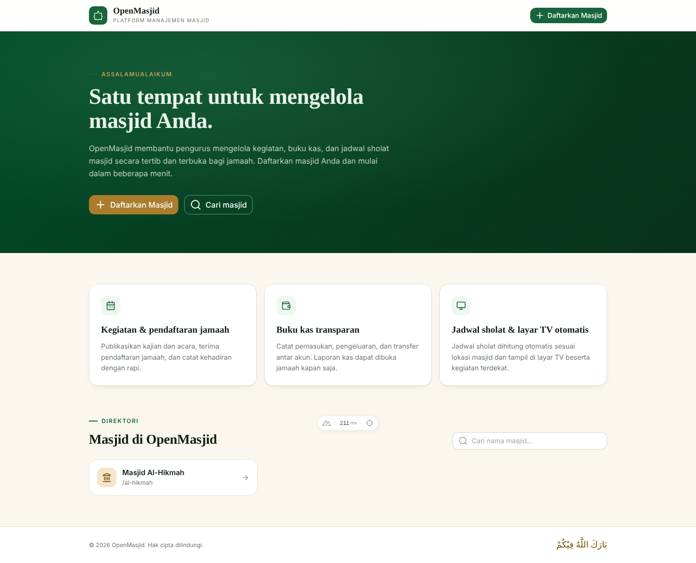
      </a>
      <br />
      <sub><b>🌐 Platform</b><br />Cari masjid & direktori</sub>
    </td>
    <td width="50%" align="center">
      <a href="docs/screenshot/onboarding.png">
        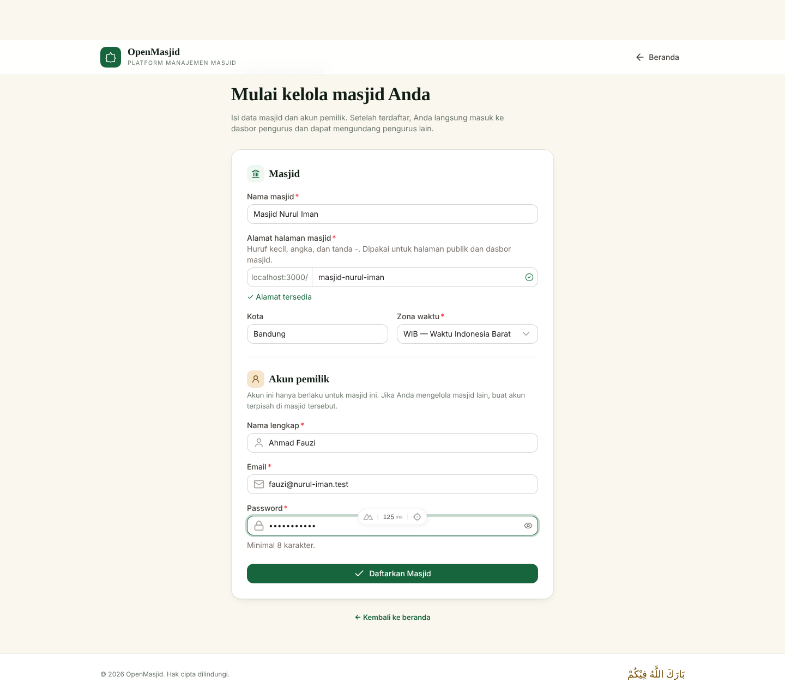
      </a>
      <br />
      <sub><b>📝 Daftarkan Masjid</b><br />Onboarding mandiri + akun pemilik</sub>
    </td>
  </tr>
  <tr>
    <td width="50%" align="center">
      <a href="docs/screenshot/tv-display.png">
        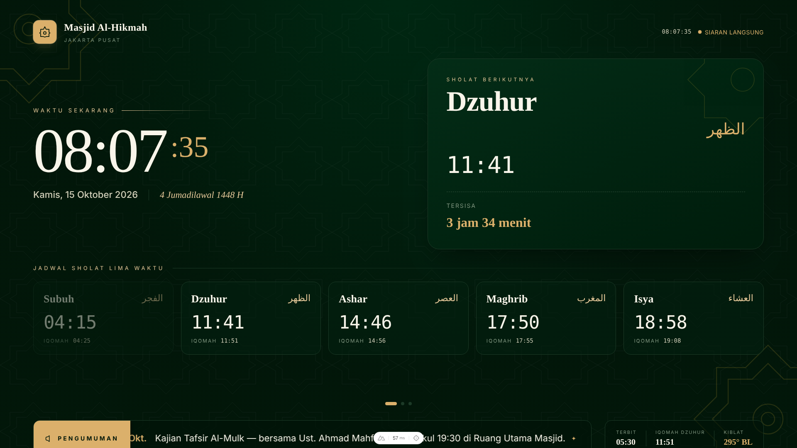
      </a>
      <br />
      <sub><b>📺 TV Display</b><br />Layar besar — jam, jadwal sholat, & pengumuman</sub>
    </td>
    <td width="50%" align="center">
      <a href="docs/screenshot/admin-dashboard.png">
        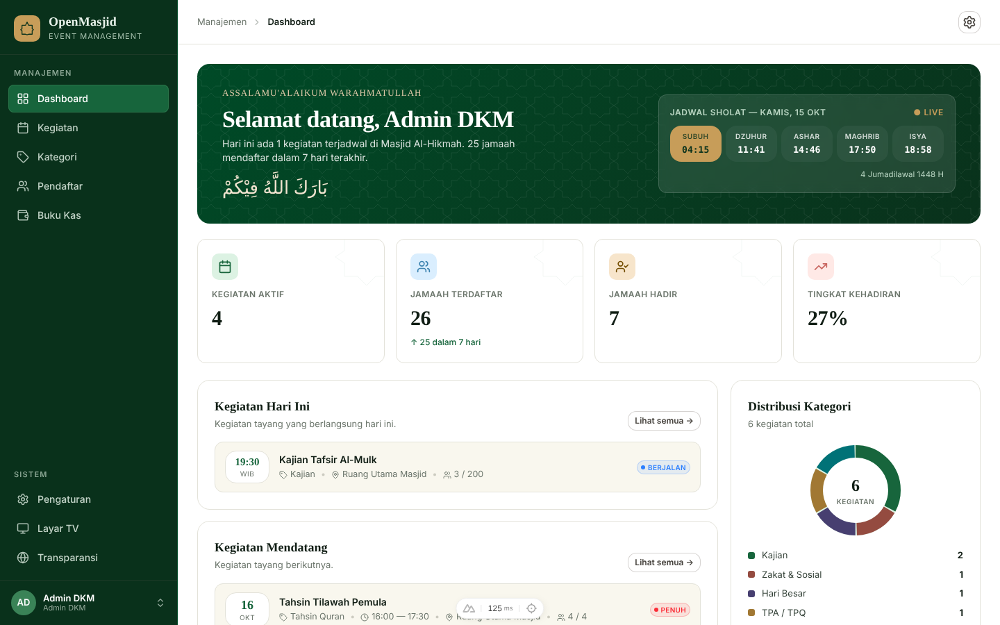
      </a>
      <br />
      <sub><b>📊 Dashboard Admin</b><br />Ringkasan kegiatan, jamaah, kas, & kehadiran</sub>
    </td>
  </tr>
  <tr>
    <td width="50%" align="center">
      <a href="docs/screenshot/admin-events.png">
        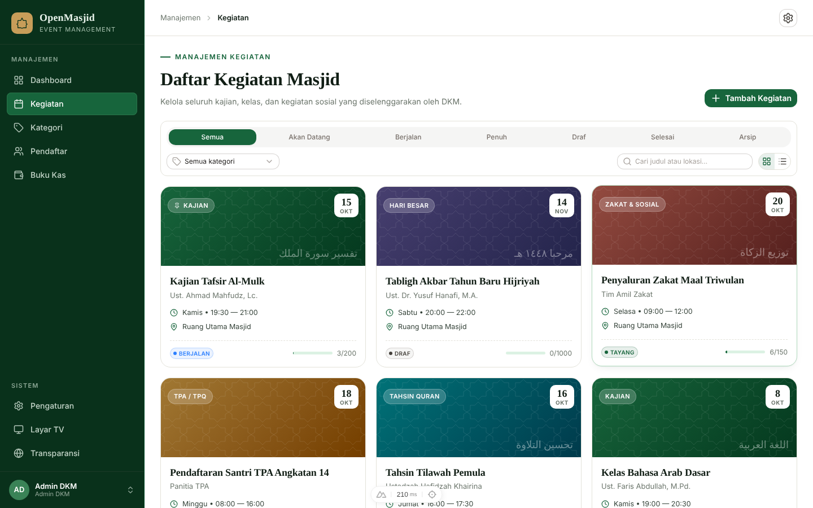
      </a>
      <br />
      <sub><b>📅 Daftar Kegiatan</b><br />List kegiatan dengan filter, pencarian, & statistik</sub>
    </td>
    <td width="50%" align="center">
      <a href="docs/screenshot/admin-categories.png">
        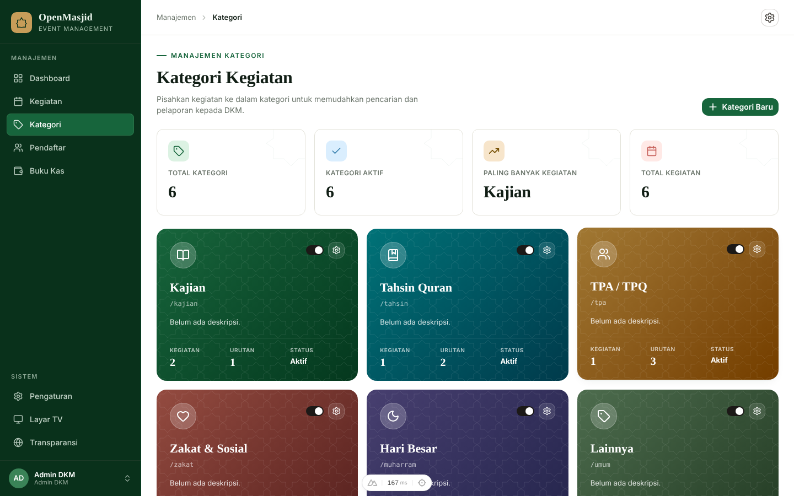
      </a>
      <br />
      <sub><b>🏷️ Kategori Kegiatan</b><br />Kajian, Tahsin, TPA, Zakat, Hari Besar Islam</sub>
    </td>
  </tr>
  <tr>
    <td width="50%" align="center">
      <a href="docs/screenshot/admin-registrants.png">
        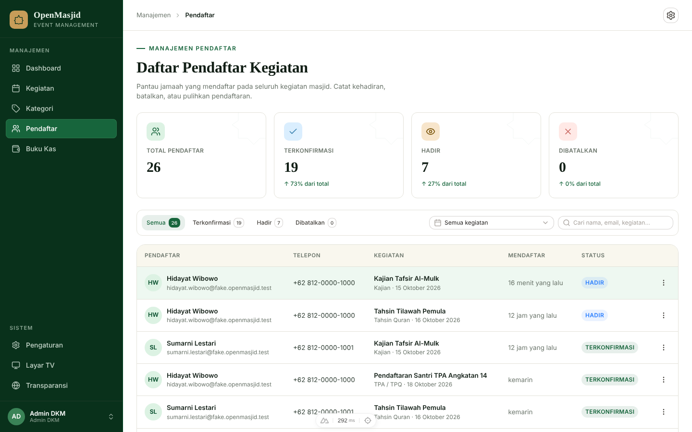
      </a>
      <br />
      <sub><b>👥 Pendaftar</b><br />Daftar jamaah & status kehadiran per kegiatan</sub>
    </td>
    <td width="50%" align="center">
      <a href="docs/screenshot/portal-jamaah.png">
        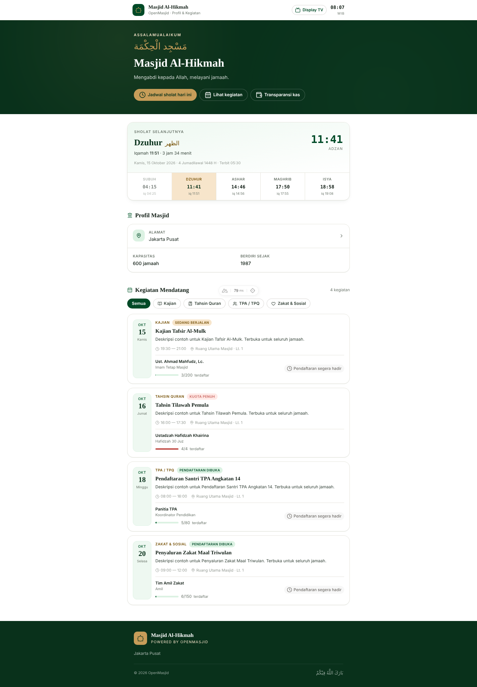
      </a>
      <br />
      <sub><b>🕌 Portal Jamaah</b><br />Halaman publik profil & kegiatan masjid</sub>
    </td>
  </tr>
  <tr>
    <td width="50%" align="center">
      <a href="docs/screenshot/admin-cashbook.png">
        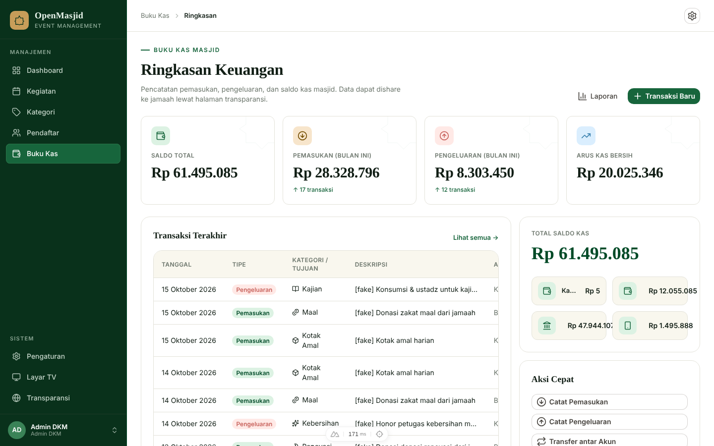
      </a>
      <br />
      <sub><b>💰 Buku Kas</b><br />Saldo, pemasukan, pengeluaran & transaksi terbaru</sub>
    </td>
    <td width="50%" align="center">
      <a href="docs/screenshot/admin-settings.png">
        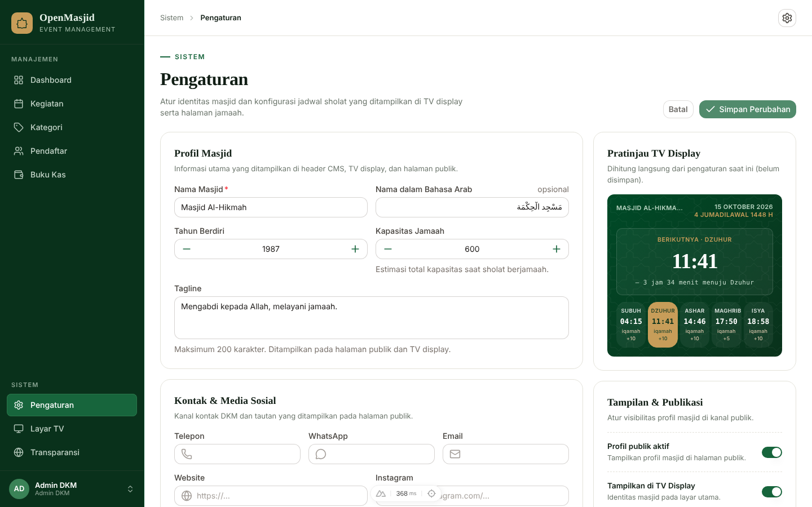
      </a>
      <br />
      <sub><b>⚙️ Pengaturan</b><br />Profil masjid & perhitungan jadwal sholat</sub>
    </td>
  </tr>
  <tr>
    <td width="50%" align="center">
      <a href="docs/screenshot/transparency.png">
        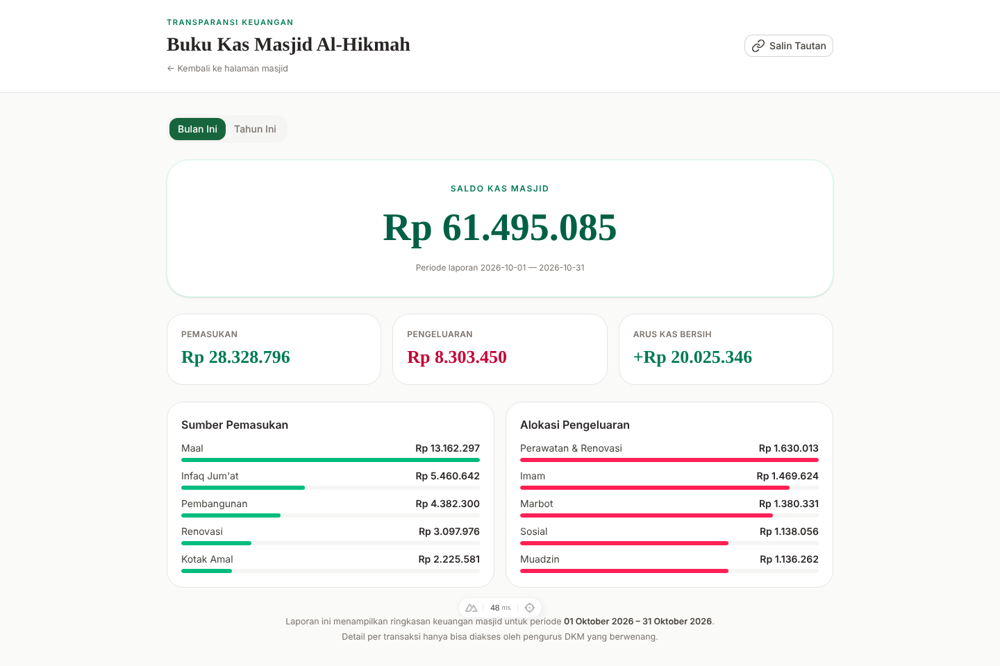
      </a>
      <br />
      <sub><b>🔍 Transparansi</b><br />Ringkasan keuangan publik untuk jamaah</sub>
    </td>
    <td width="50%" align="center">
      <a href="docs/screenshot/admin-team.png">
        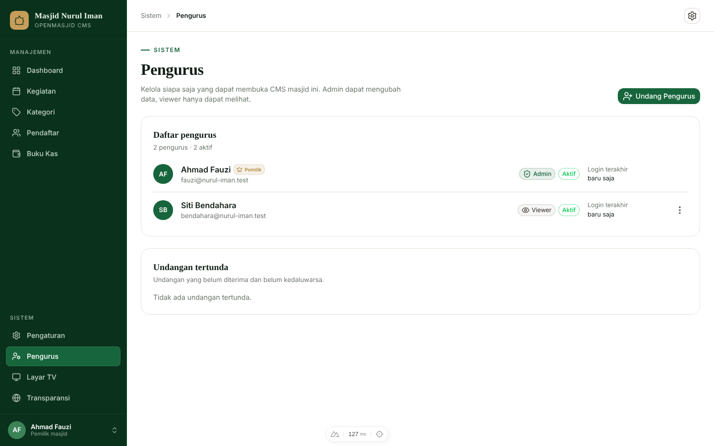
      </a>
      <br />
      <sub><b>🧑‍🤝‍🧑 Pengurus</b><br />Undangan & peran pengurus (pemilik)</sub>
    </td>
  </tr>
</table>

---

## Struktur Halaman

| Rute | Mode | Deskripsi |
|------|------|-----------|
| `/` | Publik | Landing: cari masjid (nama/kota) → beranda masjid, plus direktori |
| `/register` | Publik | Daftarkan masjid baru (membuat akun pemilik) |
| `/<masjid>` | Publik | Portal jamaah — profil, jadwal sholat & kegiatan |
| `/<masjid>/display` | Publik TV | Tampilan layar besar |
| `/<masjid>/transparency` | Publik | Ringkasan keuangan untuk jamaah |
| `/<masjid>/auth/login` | Auth | Login pengurus masjid tersebut |
| `/<masjid>/auth/forgot-password`, `/reset-password` | Auth | Reset password |
| `/<masjid>/auth/accept-invite` | Auth | Terima undangan pengurus |
| `/<masjid>/admin` | Admin | Dashboard |
| `/<masjid>/admin/events/**` | Admin | Kegiatan: daftar, detail, tambah, ubah |
| `/<masjid>/admin/registrants` | Admin | Pendaftar & check-in |
| `/<masjid>/admin/categories` | Admin | Kategori kegiatan |
| `/<masjid>/admin/cashbook/**` | Admin | Buku kas: ringkasan, transaksi, akun, kategori, laporan |
| `/<masjid>/admin/settings` | Admin | Pengaturan masjid & jadwal sholat |
| `/<masjid>/admin/team` | Pemilik | Kelola pengurus & undangan |

Akun berlaku **per masjid**: pengurus dan jamaah masjid A tidak bisa masuk ke masjid B dengan akun yang sama.
Peran: `admin` (kelola data), `viewer` (lihat saja), dan **pemilik** (admin yang juga mengelola pengurus).

---

## Menjalankan Project

1. Install dependencies:
   ```bash
   bun install
   ```
2. Salin `.env.example` menjadi `.env` lalu isi `DATABASE_URL`, `DATABASE_DIRECT_URL`,
   `BETTER_AUTH_SECRET` (`openssl rand -base64 32`), `BETTER_AUTH_URL`, `SEED_TENANT_*`, dan `SEED_ADMIN_*`.
3. Siapkan database:
   ```bash
   bun run db:migrate   # terapkan migrasi (pakai DATABASE_DIRECT_URL / role owner)
   # sekali saja: buat role aplikasi tanpa BYPASSRLS, lalu pakai di DATABASE_URL
   psql "$DATABASE_DIRECT_URL" -f server/db/sql/app-role.sql
   bun run db:seed      # satu masjid contoh + akun pemiliknya
   # opsional, data contoh:
   bun run db:seed:events
   bun run db:seed:cashbook
   ```
4. Jalankan dev server:
   ```bash
   bun run dev
   ```
   Aplikasi tersedia di `http://localhost:3000`; masjid contoh ada di `/<SEED_TENANT_SLUG>`, CMS-nya di
   `/<SEED_TENANT_SLUG>/auth/login` dengan akun `SEED_ADMIN_*`. Masjid lain bisa didaftarkan di `/register`.

Pemeriksaan kualitas & build production:

```bash
bun run lint
bun run typecheck
bun run test:isolation   # uji isolasi antar masjid (server harus jalan)
bun run build && bun run preview
```


---

## Lisensi

Project internal — TBD.
