# Desain Arsitektur Multi-Tenant — OpenMasjid

> Status: **usulan desain**, belum diimplementasikan. Basis: stack saat ini (Nuxt 4, Nuxt UI, Drizzle,
> Zod, Better Auth, PostgreSQL). Dokumen ini menjelaskan cara mengubah OpenMasjid dari satu masjid per
> deployment menjadi satu platform untuk banyak masjid (SaaS).

---

## 1. Tujuan & batasan

**Tujuan**
- Satu deployment & satu database melayani ribuan masjid (tenant). Mayoritas tenant kecil:
  puluhan kegiatan per bulan dan ratusan transaksi kas per bulan.
- Data antar-masjid **terisolasi total**. Kebocoran data keuangan atau jamaah adalah risiko paling serius.
- Pengurus bisa mengelola lebih dari satu masjid. Jamaah memakai satu akun untuk mendaftar kegiatan di
  masjid mana pun.
- Setiap masjid punya alamat sendiri: subdomain `alhikmah.openmasjid.id`, dan opsional domain sendiri
  `masjidalhikmah.or.id`.
- Onboarding mandiri: daftar, buat masjid, langsung pakai.

**Di luar cakupan tahap awal**
- Database terpisah per tenant (lihat §3: hanya sebagai jalan keluar untuk tenant sangat besar).
- Kustomisasi kode per tenant. Semua tenant memakai kode yang sama; perbedaan hanya lewat pengaturan & feature flag.

---

## 2. Gambaran besar

```mermaid
flowchart LR
  subgraph Klien
    J[Jamaah<br/>alhikmah.openmasjid.id]
    A[Pengurus DKM<br/>alhikmah.openmasjid.id/admin]
    TV[Layar TV<br/>/display?device=…]
    P[Platform admin<br/>app.openmasjid.id/platform]
  end

  J & A & TV & P --> MW

  subgraph Nuxt["Nuxt server (Nitro)"]
    MW[1. tenant resolver<br/>Host → tenant_id] --> AUTH[2. Better Auth<br/>session + membership]
    AUTH --> H[3. API handler<br/>requireTenantRole]
    H --> TDB[4. withTenant&#40;tenantId&#41;<br/>tx + SET LOCAL app.tenant_id]
  end

  TDB --> PG[(PostgreSQL<br/>shared schema<br/>+ Row Level Security)]
  H --> OBJ[(Object storage<br/>tenants/&lt;id&gt;/…)]
```



Isolasi data dijaga oleh empat lapis yang saling menutup celah:

| Lapis | Mekanisme | Mencegah |
|---|---|---|
| 1. Routing | Tenant ditentukan dari **Host**, bukan dari input user | User memilih tenant sembarangan lewat parameter |
| 2. Otorisasi | `requireTenantRole(event, roles)` memeriksa keanggotaan user di tenant itu | User masjid A memakai sesinya di masjid B |
| 3. Query | Semua query lewat `withTenant()` dan helper `scoped()` yang otomatis menambah `tenant_id = $1` | Developer lupa `WHERE tenant_id` |
| 4. Database | **Row Level Security** + composite foreign key `(tenant_id, id)` | Bug di lapis 1–3, dan referensi silang tenant lewat FK |

---

## 3. Model tenancy: shared database, shared schema, kolom `tenant_id`

| Opsi | Kelebihan | Kekurangan | Keputusan |
|---|---|---|---|
| **A. Shared schema + `tenant_id` + RLS** | Satu set migrasi, murah, cocok untuk ribuan tenant kecil, query lintas-tenant mudah untuk platform | Isolasi bergantung pada disiplin + RLS | ✅ **Dipilih** |
| B. Schema per tenant | Isolasi lebih kuat, restore per tenant mudah | Migrasi × N schema, katalog Postgres membengkak, pooler & Drizzle jadi rumit | ❌ |
| C. Database per tenant | Isolasi terkuat | Biaya & operasional tinggi, tidak masuk akal untuk masjid kecil | ❌ (hanya jalan keluar untuk tenant "enterprise", lihat §12) |

Desain A tetap membuka jalan ke C untuk tenant tertentu. Semua data tenant sudah berlabel `tenant_id`,
sehingga bisa diekspor ke database terpisah tanpa mengubah skema.

---

## 4. Model data

### 4.1 Tabel global (tanpa `tenant_id`)

| Tabel | Isi |
|---|---|
| `users` | Identitas global: email, nama, telepon, `platform_role` (`superadmin` \| `user`) |
| `sessions`, `accounts`, `verifications` | Better Auth (sudah ada). `sessions` + kolom `active_tenant_id` |
| `tenants` | = tabel `organization` Better Auth: `id`, `slug` (unik global), `name`, `status` (`trial` \| `active` \| `suspended` \| `deleted`), `plan_id`, `created_at` |
| `tenant_members` | = `member` Better Auth: `(tenant_id, user_id)` unik, `role` |
| `tenant_invitations` | = `invitation` Better Auth: undangan pengurus via email |
| `tenant_domains` | `domain` (unik), `tenant_id`, `is_primary`, `verified_at`. Untuk domain kustom |
| `plans`, `subscriptions` | Paket & langganan (fase akhir) |
| `platform_audit_log` | Aksi superadmin (impersonate, suspend, …) |

### 4.2 Tabel tenant-scoped (wajib `tenant_id uuid NOT NULL`)

`mosque_profiles` (pengganti singleton `mosque_profile`, 1:1 dengan tenant), `categories`, `events`,
`event_speakers`, `event_agenda_items`, `registrants`, `cash_accounts`, `transaction_categories`,
`transactions`, serta tabel mendatang (`announcements`, `media_assets`, `display_devices`, `audit_log`).

Aturan untuk setiap tabel tenant-scoped:

```ts
// server/db/schema/_columns.ts
export const tenantId = {
  tenantId: uuid('tenant_id').notNull().references(() => tenants.id, { onDelete: 'cascade' }),
}

// contoh: events
export const events = pgTable('events', {
  id: uuid('id').primaryKey().defaultRandom(),
  ...tenantId,
  categoryId: uuid('category_id').notNull(),
  slug: text('slug').notNull(),
  // …
}, (t) => [
  // (a) unik per tenant, bukan global
  uniqueIndex('events_tenant_slug_unique').on(t.tenantId, t.slug).where(sql`${t.deletedAt} IS NULL`),
  // (b) target untuk composite FK dari tabel anak
  unique('events_tenant_id_id_unique').on(t.tenantId, t.id),
  // (c) composite FK: kategori HARUS milik tenant yang sama
  foreignKey({ columns: [t.tenantId, t.categoryId], foreignColumns: [categories.tenantId, categories.id] }),
  // (d) index diawali tenant_id
  index('events_tenant_status_start_idx').on(t.tenantId, t.status, t.startDate),
  // (e) RLS
  pgPolicy('tenant_isolation', {
    as: 'permissive', for: 'all', to: appUser,
    using: sql`${t.tenantId} = current_setting('app.tenant_id', true)::uuid`,
    withCheck: sql`${t.tenantId} = current_setting('app.tenant_id', true)::uuid`,
  }),
]).enableRLS()
```

**Kenapa composite FK wajib:** pengecekan foreign key di PostgreSQL **tidak tunduk pada RLS**. Tanpa
composite FK, masjid A bisa membuat transaksi dengan `account_id` milik masjid B, karena FK biasa hanya
memeriksa bahwa id itu ada. Dengan `(tenant_id, account_id) → cash_accounts(tenant_id, id)`, database
sendiri yang menolak referensi silang tenant.

Pasangan composite FK yang dibutuhkan:

| Anak | Induk |
|---|---|
| `events.(tenant_id, category_id)` | `categories` |
| `event_speakers`, `event_agenda_items`, `registrants` `.(tenant_id, event_id)` | `events` |
| `transactions.(tenant_id, account_id)` dan `(tenant_id, destination_account_id)` | `cash_accounts` |
| `transactions.(tenant_id, category_id)` | `transaction_categories` |
| `transaction_categories.(tenant_id, parent_id)` | `transaction_categories` |

Kolom yang merujuk `users` (`created_by`, `registrants.user_id`) tetap FK biasa, karena `users` bersifat global.

### 4.3 Jamaah & privasi

- `users` global, tapi **masjid hanya boleh melihat jamaah yang punya hubungan dengan tenant-nya**:
  membership atau pendaftaran (`registrants`) di tenant itu. Endpoint admin tidak pernah membaca
  `users` langsung. Data jamaah selalu diakses lewat join dari `registrants`/`tenant_members` yang ter-scope.
- Data profil yang khusus per masjid (catatan DKM, nomor anggota) disimpan di `tenant_members` atau
  `jamaah_profiles(tenant_id, user_id, …)`, tidak di `users`.
- Kepatuhan **UU PDP**: ekspor & penghapusan data per tenant (§10), dan penghapusan akun jamaah global.

---

## 5. Resolusi tenant (Host → tenant)

```
alhikmah.openmasjid.id            → tenants.slug = 'alhikmah'
masjidalhikmah.or.id              → tenant_domains.domain (verified)
app.openmasjid.id                 → tanpa tenant: landing, signup, pilih masjid, /platform
localhost:3000 (dev)              → header X-Tenant / query ?tenant= / env DEV_TENANT_SLUG
```

Server middleware Nitro `server/middleware/00.tenant.ts`:

1. Baca `getRequestHost(event)` (hanya percayai `X-Forwarded-Host` dari proxy yang dikenal).
2. Cari tenant di cache LRU in-memory (TTL ±60 detik, invalidasi saat domain/slug berubah). Jika tidak ada di cache, query DB.
3. Isi `event.context.tenant = { id, slug, status, timezone, plan }`.
4. Jika tenant `suspended`, kembalikan halaman/403 khusus. Endpoint `/api/public/**` milik tenant
   yang tidak dikenal mengembalikan 404.

Di sisi app: plugin `app/plugins/tenant.ts` mengambil `useRequestEvent().context.tenant` saat SSR, lalu
menyimpannya di `useState('tenant')` agar composable seperti `useTenant()` bisa membacanya.

**Tidak pernah** menerima `tenantId` dari body/query untuk endpoint tenant. Satu-satunya sumber adalah Host.

---

## 6. Auth & otorisasi (Better Auth)

### 6.1 Plugin
- `organization()` dipakai sebagai tenant. Tabelnya dipetakan ke `tenants`, `tenant_members`, dan
  `tenant_invitations` lewat `schema` mapping. Fitur bawaannya: undangan email, `activeOrganizationId`
  di session, dan access control.
- `admin()` untuk `platform_role` superadmin, ban user, dan impersonation (tercatat di audit log).

### 6.2 Peran per tenant (`tenant_members.role`)

| Role | Akses |
|---|---|
| `owner` | Semua, termasuk billing, hapus masjid, transfer kepemilikan. Minimal 1 per tenant |
| `admin` | CRUD semua modul + kelola anggota (kecuali owner) |
| `bendahara` | CRUD Buku Kas; baca modul lain |
| `editor` | CRUD kegiatan, pendaftar, pengumuman; tanpa Buku Kas |
| `viewer` | Baca saja |

Jamaah **tidak** menjadi member. Hubungan jamaah dengan masjid cukup lewat `registrants`. Ini menjaga
tabel member tetap kecil, dan jamaah tidak bisa membuka CMS.

Hak akses didefinisikan sekali dengan `createAccessControl` (statement: `event`, `registrant`,
`cashbook`, `settings`, `member`, `billing`), dipakai bersama di server (`hasPermission`) dan di UI
untuk menyembunyikan tombol.

### 6.3 Guard server

```ts
// server/utils/tenant.ts
export async function requireTenantRole(event: H3Event, permission: Permission) {
  const tenant = requireTenant(event)                 // dari middleware Host
  const user = await requireAuth(event)
  const member = await getMembership(user.id, tenant.id) // cache per request
  if (!member && user.platformRole !== 'superadmin') throw createError({ statusCode: 404 }) // jangan bocorkan keberadaan
  if (!can(member?.role ?? 'owner', permission)) throw createError({ statusCode: 403 })
  return { tenant, user, member }
}
```

Penggantinya untuk guard yang sekarang: `requireStaff` → `requireTenantRole(event, 'x:read')`, dan
`requireAdmin` → `requireTenantRole(event, 'x:write')`.

### 6.4 Cookie & domain
- Subdomain `*.openmasjid.id`: aktifkan `advanced.crossSubDomainCookies` (domain `.openmasjid.id`), supaya
  satu login berlaku untuk semua masjid yang dikelola. Otorisasi tetap per tenant lewat membership.
- Domain kustom: cookie tidak bisa dibagi lintas domain, jadi login terpisah di domain itu. Masukkan
  domain terverifikasi ke `trustedOrigins` secara dinamis (callback `trustedOrigins` membaca `tenant_domains`).

---

## 7. Lapisan akses data

### 7.1 `withTenant` + RLS

```ts
// server/utils/db.ts
export async function withTenant<T>(tenantId: string, fn: (tx: Tx) => Promise<T>): Promise<T> {
  return db.transaction(async (tx) => {
    // SET LOCAL hanya berlaku di transaksi ini → aman dengan Supabase transaction pooler (PgBouncer)
    await tx.execute(sql`select set_config('app.tenant_id', ${tenantId}, true)`)
    return fn(tx)
  })
}
```

- Semua handler tenant memanggil `withTenant(ctx.tenant.id, tx => …)`. Helper `event.context.db` bisa
  disiapkan oleh middleware supaya handler cukup memakai `useTenantDb(event)`.
- Jika `app.tenant_id` tidak diset, `current_setting(..., true)` bernilai NULL. Policy jadi
  `tenant_id = NULL`, yang selalu false, sehingga **0 baris** (fail closed), bukan semua baris.
- Peran database:
  - `openmasjid_owner`: pemilik tabel, dipakai `drizzle-kit migrate`. Melewati RLS sebagai owner.
  - `openmasjid_app`: dipakai runtime (`DATABASE_URL`). **Tanpa** `BYPASSRLS`, bukan owner. Tambahkan
    `ALTER TABLE … FORCE ROW LEVEL SECURITY` sebagai pengaman tambahan.
  - `openmasjid_platform`: koneksi terpisah untuk console superadmin dan job lintas-tenant (laporan
    agregat, billing). Diberi `BYPASSRLS` dan hanya dipakai di `server/platform/**`.
- Policy didefinisikan di schema Drizzle (`pgPolicy`, `.enableRLS()`, `pgRole(...).existing()`) sehingga
  ikut ter-generate di migrasi.

### 7.2 Penjaga di level aplikasi
- Helper `scoped(table, tenantId)` mengembalikan kondisi `eq(table.tenantId, tenantId)`. Query tetap
  menyertakan filter tenant secara eksplisit walau RLS aktif, karena index diawali `tenant_id` dan
  planner butuh predikat itu.
- Insert selalu mengisi `tenantId` dari context, tidak pernah dari input. Skema Zod untuk input
  **tidak** memuat `tenantId` (`.omit({ tenantId: true })`).
- Aturan ESLint/CI sederhana: query ke tabel tenant di luar `withTenant` dianggap error. Implementasinya
  pakai grep di CI atau custom lint rule.

### 7.3 Cache
- Semua cache key menyertakan tenant: `tenant:<id>:prayer-times:<date>`. Ini berlaku untuk
  `defineCachedEventHandler` (`getKey` wajib memakai tenant) dan CDN (`Vary: Host`, atau cache per hostname).

---

## 8. Permukaan aplikasi

| Permukaan | Host | Catatan |
|---|---|---|
| Portal jamaah, `/transparency` | tenant | SSR publik, dapat di-cache per host |
| CMS `/admin/**` | tenant | Middleware: login + membership di tenant ini. Switcher masjid di sidebar (daftar membership → redirect ke subdomain lain) |
| Layar TV `/display` | tenant | Mode **device**: TV dipasangkan sekali via kode 6 digit → token di `display_devices(tenant_id, token_hash, name, last_seen_at)`. TV tidak perlu login user |
| Onboarding, landing, pilih masjid | `app.` | `/signup` → buat akun → `/onboarding` (nama masjid, slug, timezone, koordinat) |
| Platform console `/platform/**` | `app.` | Khusus `superadmin`: daftar tenant, suspend, impersonate, metrik, paket |

### Alur onboarding
1. User mendaftar/masuk di `app.openmasjid.id`.
2. Mengisi form "Buat masjid" (Zod: nama, slug unik, timezone, kota, koordinat opsional).
3. Dalam satu transaksi: insert `tenants`, `tenant_members(role=owner)`, `mosque_profiles`, dan seed
   default (kategori kegiatan, kategori kas, akun "Kas Tunai"). Fungsi seed ini adalah fungsi yang
   sama dengan `scripts/seed.ts`, hanya dibuat menerima `tenantId`.
4. Redirect ke `https://<slug>.openmasjid.id/admin`. Status awal `trial`.

---

## 9. Paket & batasan (fase akhir)

- `plans`: `code`, `limits` (jsonb: `maxEvents/bulan`, `maxMembers`, `storageMb`, `customDomain`,
  `tvDevices`), `features` (jsonb flag).
- `subscriptions(tenant_id, plan_id, status, current_period_end, provider, provider_ref)`. Provider
  pembayaran lokal (Midtrans/Xendit) lewat webhook.
- Guard `requireFeature(event, 'customDomain')` dan pengecekan kuota di handler create.
- Paket gratis tetap layak untuk masjid kecil. Ini proyek sosial: pastikan fitur inti (jadwal, kegiatan,
  kas sederhana, TV) tetap ada di paket gratis.

---

## 10. Operasional

- **Migrasi skema**: satu migrasi untuk semua tenant (keunggulan shared schema). Migrasi berat harus
  backward-compatible (expand → backfill → contract).
- **Backup**: PITR level database (Supabase). Restore per tenant dilakukan dengan "ekspor dari snapshot":
  restore ke DB sementara, lalu `COPY … WHERE tenant_id = $1` balik ke produksi. Sediakan skrip sebelum
  ada pelanggan berbayar.
- **Ekspor data tenant** (permintaan masjid / UU PDP): job yang menulis JSON/CSV semua tabel
  tenant-scoped ke object storage `tenants/<id>/exports/…`, lalu tautan unduh untuk owner.
- **Hapus tenant**: soft (`status = deleted`, tidak bisa diakses) → setelah 30 hari, hard delete
  `ON DELETE CASCADE` + hapus prefix object storage.
- **Noisy neighbor**: rate limit per tenant (Better Auth rate limit + middleware berbasis
  `tenant:<id>`), batas ukuran ekspor/laporan, `statement_timeout` untuk role app.
- **Observabilitas**: log & trace selalu membawa `tenant_id`. Metrik per tenant (request, error, ukuran data).
- **Object storage**: path `tenants/<tenant_id>/<modul>/<uuid>`; URL bertanda tangan; policy bucket
  memeriksa prefix.

---

## 11. Rencana migrasi dari versi single-tenant

| Fase | Isi | Keluaran |
|---|---|---|
| **0. Fondasi skema** | Tabel `tenants`, `tenant_members`, `tenant_domains`; rename `mosque_profile` → `mosque_profiles` (+`tenant_id`, hapus CHECK singleton); tambah `tenant_id` **nullable** ke semua tabel tenant-scoped | Migrasi 0003 (expand) |
| **1. Backfill** | Buat 1 tenant dari profil masjid yang ada (`id` = singleton id lama). `UPDATE … SET tenant_id = <id>`. User `role=admin/viewer` → `tenant_members` (`admin`→`owner`/`admin`, `viewer`→`viewer`) | Skrip `scripts/migrate-to-multitenant.ts` (idempoten) |
| **2. Kunci integritas** | `tenant_id SET NOT NULL`; ganti unique global → `(tenant_id, …)`; tambah `unique(tenant_id, id)` + composite FK; index diawali `tenant_id` | Migrasi 0004 (contract) |
| **3. Aplikasi** | Middleware tenant, `requireTenantRole`, `withTenant`, semua handler & skema Zod disesuaikan; `getMosqueProfile()` → per tenant; cache key per tenant; plugin organization Better Auth | Kode, test isolasi |
| **4. RLS** | Role DB `openmasjid_app` (tanpa BYPASSRLS), `pgPolicy` + `ENABLE/FORCE RLS` di semua tabel tenant; ganti `DATABASE_URL` ke role baru | Migrasi 0005 |
| **5. Self-service** | Onboarding, undangan pengurus, switcher masjid, pairing TV, domain kustom | Fitur |
| **6. Platform** | Console superadmin, paket & billing, ekspor/hapus tenant | Fitur |

Fase 0–4 bisa dirilis tanpa mengubah perilaku untuk masjid yang sudah ada, karena satu tenant hasil
backfill tetap bekerja di domain lama, yang dipetakan lewat `tenant_domains`.

---

## 12. Pengujian isolasi (wajib sebelum tenant kedua masuk)

- **Fixture dua tenant** (A & B) dengan data identik bentuknya.
- Untuk **setiap** endpoint `/api/admin/**` dan `/api/public/**`, uji otomatis dengan login sebagai
  admin A di host A:
  - Akses id milik B → 404 (bukan 403, supaya keberadaan data tidak bocor).
  - Create/update yang menyertakan id milik B (akun kas, kategori, event) → ditolak (400/404), dan
    composite FK menolak di level DB.
  - Endpoint list tidak pernah memuat baris B.
- **Test RLS langsung**: koneksi `openmasjid_app` tanpa `set_config` → 0 baris; dengan tenant A → hanya A.
- **Test sesi lintas host**: cookie A dipakai di host B tanpa membership → 404.
- Jalankan di CI dengan Postgres asli (bukan mock).

---

## 13. Keputusan yang perlu dikonfirmasi

1. **Domain**: nama domain platform (`openmasjid.id`?), dan apakah domain kustom masuk tahap awal.
2. **Peran**: apakah set `owner/admin/bendahara/editor/viewer` sudah sesuai struktur DKM?
3. **Jamaah lintas masjid**: satu akun global (usulan ini) atau akun terpisah per masjid?
4. **Transparansi keuangan**: per masjid bisa diatur publik/privat? (usulan: flag di `mosque_profiles`).
5. **Billing**: gratis seluruhnya, freemium, atau donasi? Ini menentukan apakah fase 6 diperlukan.
6. **Hosting**: tetap di Supabase (pooler transaksi → wajib `SET LOCAL` di dalam transaksi, sudah
   diakomodasi) atau Postgres terkelola lain.
7. **Drizzle 1.0**: jika sudah stabil saat implementasi, pakai RQB v2 (`defineRelations`) sekalian.
